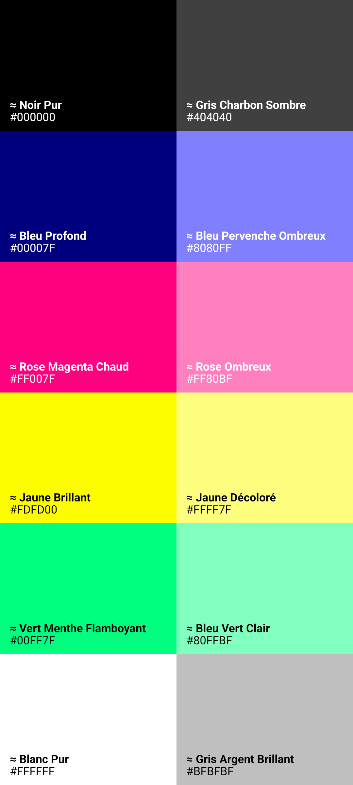

# Titre du jeu

Projet conçu en équipe avec : Rémi, Federer

## Le public cible

- Type de joueur visé (fonceur ou explorateur) : Étudiants
- Catégorie et genre : RPG, roguelike
- Le concept en une phrase (un personnage, un objectif, un obstacle) : Les caractéristiques du personnage sont basées sur celles de la Character sheet de l'étudiant.

## Les mécaniques

- Objectif du jeu : Battre le boss de fin
- Condition de victoire : Finir les X(varie selon la difficulté choisie(4 par défaut)) temples et se rendre jusqu'au boss tout en haut de sa tour
- Condition de défaite : Perdre un combat
- Mécaniques cœur :
    - Exploration ()
    - Donjons ()
    - Combat ()
    - Génération procédurale (Chaque zone est générée procéduralement)
    - Mort permanente (Quand le joueur perd un combat, il doit recommencer du début)
    - Personnalisation ()
- Mécaniques secondaires :
    - Score ()
    - Secrets ()
    - Objets ()
- Structure (progressif ou émergent, expliquez en quelques mots) : ...
- Prototype Scratch (facultatif) : [lien du projet](lien)

## Les phases de jeu

- La boucle de jeu (action → rétroaction → récompense) : Exploration -> Quête/Combat/Nouvel endroit -> Or/Exp/Coffre(Objet)
- Phase 0 : Menu (règles, contrôles, interface)
    Contrôles:
      - Déplacer le curseur: A,S,W,D
      - Confirmer la sélection : Barre d'espace
    - Transition vers la phase précédente : Sélectionner "Fermer" dans le menu
- Phase 1 : Ville (règles, contrôles, interface)
    Contrôles:
      - Se déplacer: A,S,W,D
      - Ouvrir le menu: E
      - Interagir avec qqchose: Barre d'espace
    - Transition vers la phase 0 : Appuyer sur E
    - Transition vers la phase 2 : Entrer dans une boutique
    - Transition vers la phase 3 : Quitter la ville
- Phase 2 : Boutique (règles, contrôles, interface)
    Contrôles:
      - Déplacer le curseur: A,S,W,D
      - Confirmer la sélection : Barre d'espace
    - Transition vers la phase 1 : Sélectionner "Quitter" dans le menu de boutique
- Phase 3 : Carte du monde (règles, contrôles, interface)
    Contrôles:
      - Se déplacer: A,S,W,D
      - Ouvrir le menu: E
      - Interagir avec qqchose: Barre d'espace
    - Transition vers la phase 0 : Appuyer sur E
    - Transition vers la phase 1 : Se déplacer sur une ville     
    - Transition vers la phase 4 : Se déplacer sur un donjon
    - Transition vers la phase 5 : Tomber sur une rencontre aléatoire
- Phase 4 : Donjon (règles, contrôles, interface)
    Contrôles:
      - Se déplacer: A,S,W,D
      - Ouvrir le menu: E
      - Interagir avec qqchose: Barre d'espace
    - Transition vers la phase 0 : Appuyer sur E
    - Transition vers la phase 3 : Quitter le donjon (après avoir obtenu la clé en battant son boss)
    - Transition vers la phase 5 : Entrer en contact avec un ennemi
- Phase 5 : Combat (règles, contrôles, interface)
    Contrôles:
      - Déplacer le curseur: A,S,W,D
      - Confirmer la sélection : Barre d'espace
    - Transition vers la phase précédente : Gagner le combat

## Le fun et le flow

- La source du fun pour le type de joueur visé (sans utiliser le mot *fun*) : ...
- Le flow (équilibre défi / capacités) : ...
- La rétroaction (son, lumière, animation) : ...
- La rejouabilité (pourquoi recommencer) : nouveau record, génération procédurale, lien avec Character sheet, découvrir secrets, essayer avec nouvelle difficulté

## L'histoire

- Le personnage principal (description, désir, besoin, habiletés spéciales) : ...
- Le début (phase de jeu ou transition associée) : , (Ville)
- Le milieu (phase de jeu ou transition associée) : Le personnage doit battre le boss de chaque donjon pour obtenir les fragments de l'arme capable de battre le boss de fin, (Carte du monde)
- Le revirement (phase de jeu ou transition associée) : , (Combat)
- La fin (phase de jeu ou transition associée) : , (Fin)
- L'univers (où, quand, un élément de folklore) : ...
- Comment la mécanique cœur exprime le désir du personnage : ...

## L'esthétique et l'interface

- Le style visuel (et pourquoi il convient à votre jeu) : 
    - IU : Basé sur la character sheet (pour bien intégrer le jeu)
    - Personnages, monstres, tileset, etc. : Pixel art avec coins arrondis (identité visuelle simple, uniforme et facile à produire)
- La palette de couleurs : 
- Trois images de référence (avec lesquelles j'ai testé la palette) : [image 1](lien), [image 2](lien), [image 3](lien)
- L'ambiance sonore : ...
- Les objets jouables :
    - De base : potions(soin, antidote, altération d'état, etc.), armes simples(épée, arc, bâton, hache, etc.), pièces d'équipement, enchantements permanents pour les armes
    - Spéciaux(projets désignés objets par le joueur qui doit aussi indiquer quel type d'objet(les stats de l'objet dépendent de ceux du projet)) : Armes(de proche, magique, lancée ou à munitions), pièges plaçables en phase d'exploration(empoisonne, paralyse, explose, brûle, etc.), pièces d'équipement, potions
- Croquis de l'interface :

## Les ressources

- Son d'ambiance : [titre du son](lien)
- Crédits :
    - « Titre de l'image », par ..., [Source](lien), [Licence](lien)
    - « Titre du son », par ..., [Source](lien), [Licence](lien)
